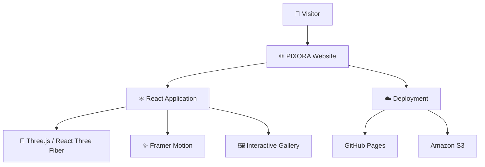

 
<div align="center">


<br/>

[](http://pixora-mohit-jadon-2026.s3-website.ap-south-1.amazonaws.com/)
[](https://mohitsinghjadon07-png.github.io/PIXORA/)
[](https://github.com/mohitsinghjadon07-png/PIXORA)

<br/>

**A cinematic photography gallery built to make every photograph feel like an experience.**

</div>

---

## ✦ About PIXORA

PIXORA is a cinematic, interactive photography gallery that combines modern web technologies with immersive 3D visuals and smooth motion effects.

Designed around a dark, editorial aesthetic, PIXORA transforms a traditional photo gallery into a visually engaging experience.

The project also demonstrates cloud deployment using **Amazon Web Services (AWS) S3** alongside GitHub Pages.

## ✨ Features

| Feature | Description |
|---|---|
| 3D Visual Experience | Floating 3D photography elements |
| Cinematic Interface | Dark luxury-inspired visual design |
| Smooth Animations | Motion effects and interactive transitions |
| Interactive Gallery | Explore and interact with photographs |
| Image Upload Preview | Select and preview images locally |
| Responsive Design | Designed for different screen sizes |
| Lightbox Experience | View photographs in an expanded view |
| Dual Deployment | Hosted on GitHub Pages and AWS S3 |

> **Note:** Image uploads currently provide local browser previews. Permanent cloud storage for visitor-uploaded photographs is not implemented yet.

## 🛠️ Tech Stack

<div align="center">


</div>

## 🏗️ Architecture

PIXORA uses a React-based frontend, built with Vite and deployed to two hosting platforms.



### AWS Deployment

The production build is hosted in an Amazon S3 bucket configured for static website hosting.

**AWS Configuration**

| Component | Configuration |
|---|---|
| Cloud Provider | Amazon Web Services |
| Storage Service | Amazon S3 |
| Bucket | `pixora-mohit-jadon-2026` |
| AWS Region | Asia Pacific (Mumbai) |
| Region Code | `ap-south-1` |
| Hosting | S3 Static Website Hosting |
| Access | Public read for website objects |
| Entry Document | `index.html` |

### Deployment Flow

```text
React Source Code
       |
       ▼
    Vite Build
       |
       ▼
 Production Files
       |
       ▼
   index.html
   assets/
       |
       ▼
   Amazon S3
       |
       ▼
  Static Website
```

## 🚀 Live Deployments

<div align="center">

### ☁️ AWS S3 Deployment

[](http://pixora-mohit-jadon-2026.s3-website.ap-south-1.amazonaws.com/)

`http://pixora-mohit-jadon-2026.s3-website.ap-south-1.amazonaws.com/`

### 🐙 GitHub Pages Deployment

[](https://mohitsinghjadon07-png.github.io/PIXORA/)

`https://mohitsinghjadon07-png.github.io/PIXORA/`

### 💻 Source Code

[](https://github.com/mohitsinghjadon07-png/PIXORA)

</div>

## ⚙️ Run Locally

Want to explore the project on your own machine?

**1. Clone the repository**

```bash
git clone https://github.com/mohitsinghjadon07-png/PIXORA.git
```

**2. Enter the project directory**

```bash
cd PIXORA
```

**3. Install dependencies**

```bash
npm install
```

**4. Start the development server**

```bash
npm run dev
```

**5. Create a production build**

```bash
npm run build
```

The production-ready files will be generated inside the `dist/` directory.

## 📁 Project Structure

```text
PIXORA/
│
├── public/
│
├── src/
│   ├── components/
│   │   └── Hero3D.jsx
│   │
│   ├── App.jsx
│   ├── main.jsx
│   └── style.css
│
├── index.html
├── package.json
├── vite.config.js
└── README.md
```

## 🎯 Project Objectives

- Explore immersive 3D experiences in modern web development.
- Build interactive interfaces using React.
- Integrate animation into a photography-focused experience.
- Understand production builds and static website hosting.
- Gain practical experience with AWS S3 cloud deployment.
- Deploy and maintain a project across multiple platforms.

## 🔮 Future Improvements

- Permanent image uploads using Amazon S3.
- Secure upload handling through presigned URLs.
- User authentication and personal galleries.
- Image collections and cloud-backed storage.
- CloudFront CDN integration for HTTPS and improved content delivery.

## 👨‍💻 Developer

<div align="center">

### MOHIT JADON

**Cyber Security Student | Developer | Cloud Learner**

Building projects at the intersection of technology, creativity and real-world applications.

[](https://github.com/mohitsinghjadon07-png)

</div>

---

<div align="center">

**PIXORA — YOUR WORLD. YOUR FRAMES.**


<sub>Designed and developed with curiosity and code.</sub>

</div>
